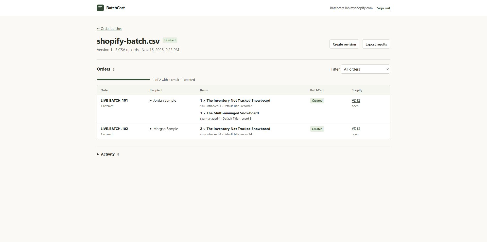
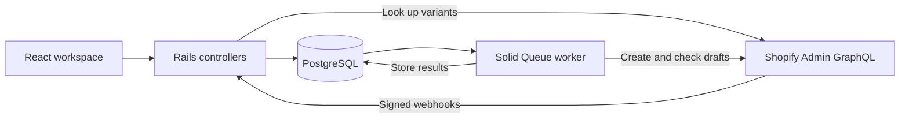
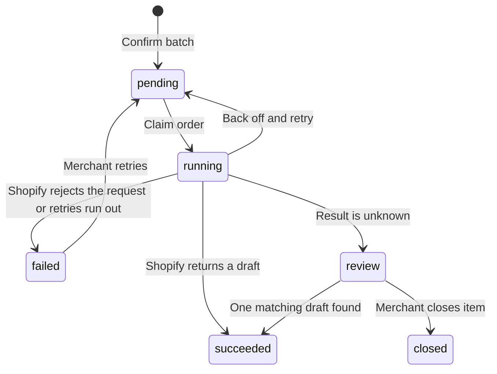

# BatchCart

Upload a CSV with one row per product, check the grouped orders, then create the drafts in Shopify. BatchCart is built for jobs like a school fundraiser where one spreadsheet contains orders for several recipients. [Original use case on Shopify Community](https://community.shopify.com/t/can-you-use-a-customer-segment-to-create-bulk-orders/379437)



The screenshot is from a Shopify development store. Three CSV rows became two drafts, and the export kept one row per product with its Shopify draft ID. Shopify delivered three create events across the smoke test and batch. Editing the first draft's note delivered an update that BatchCart verified and synced. Shop isolation is covered by automated tests with two simulated shops. The delete and uninstall subscriptions were registered during the live run.

## Try it locally

You need Docker with Compose. From the repo root, create `.env` with `cp .env.example .env` in Bash or `Copy-Item .env.example .env` in PowerShell. Then start the containers.

```sh
docker compose up -d --build
```

1. Open the app and choose **Open demo shop**. [localhost:3000](http://localhost:3000)
2. Upload the sample with an invalid quantity in record 4. Click the record number, change the quantity to `1`, and save. [CSV with a validation error](test/fixtures/files/mixed.csv)
3. Review the two grouped orders, click **Create 2 draft orders**, and download the results. The demo uses a seeded catalog and stores its simulated drafts in PostgreSQL. The same worker runs in both modes.

Use the template to build your own CSV. Repeat an already confirmed import in the same shop to see the duplicate warning. [CSV template](public/order-template.csv)

## Connect a Shopify dev store

1. Create a dev store and a standalone app in Dev Dashboard. Use the scopes and callback in the example TOML. Set the app URL to an HTTPS origin that forwards to BatchCart. [Shopify dev stores](https://shopify.dev/docs/apps/build/stores/development-stores) · [Example configuration](shopify.app.example.toml)
2. Enable protected customer data access for names, email and shipping addresses on the development app. Register the webhook subscriptions from the example TOML. With Shopify CLI you can copy the file to `shopify.app.local.toml`, set your app's client ID and URLs, and deploy it to the development app. [Protected customer data setup](https://shopify.dev/docs/apps/launch/protected-customer-data)
3. In `.env`, set `BATCHCART_DEMO=0`, `APP_URL`, `SHOPIFY_CLIENT_ID`, `SHOPIFY_CLIENT_SECRET`, and `SHOPIFY_DEV_SHOPS` (comma-separated `.myshopify.com` domains). Run `openssl rand -hex 64` twice to generate separate values for `SECRET_KEY_BASE` and `DATA_ENCRYPTION_KEY`. With Docker, you can also use `docker run --rm ruby:3.4-slim ruby -rsecurerandom -e 'puts SecureRandom.hex(64)'`. Use the same pair in both web and worker containers and keep it across restarts.
4. Run `docker compose up -d` and open the HTTPS app URL. Sign in as the store owner. Replace the template SKUs with ones from your dev store, or create products with the template SKUs. Use synthetic recipients and leave the resulting drafts open.
5. Open a draft from the results table to check the products, quantities and shipping address in Shopify Admin. Edit its note to exercise the update webhook.

The online OAuth grant checks the store owner. The offline grant gives the worker a renewable token. BatchCart encrypts tokens and imported recipient details in PostgreSQL and uses Shopify Admin GraphQL `2026-10`. [Shopify's standalone app authentication guide](https://shopify.dev/docs/apps/build/authentication-authorization/authenticate-standalone-apps)

## What happens after confirmation



Rows with the same order reference must have the same recipient. Missing or ambiguous SKUs and repeated SKUs within an order block confirmation. Uploads must be UTF-8 and fit within 1,500 records and 1 MB. Fixing a row creates a new version. Confirming locks that version and checks for duplicates using the recipient details, variant IDs and quantities. Renaming an order reference or sorting the CSV still finds the same match.



The worker records each claim before calling Shopify. A PostgreSQL advisory lock limits API work to one worker at a time per shop. The dispatcher scans for pending work every 15 seconds, so a confirmed batch can resume after a missed queue handoff. Pause stops new claims while the current request finishes.

Shopify may create a draft even if the request times out. BatchCart puts the order in **Needs reconciliation** and looks for its unique `bc-…` tag before recording a result. It accepts one matching draft. With no match or multiple matches, the order stays in review. A merchant can check again or close the unresolved item. Keep the tag on the Shopify draft so the lookup can find it.

On HTTP 429 or a GraphQL throttle, the worker backs off using Shopify's query-cost budget. A permissions error pauses the batch. Signed webhooks are deduplicated by delivery ID and queue a fresh GraphQL read. Periodic reads catch missed updates, and older Shopify timestamps cannot overwrite newer ones.

## Tests and benchmark

With the demo containers running, use the same commands as CI.

```sh
docker compose run --rm -e RAILS_ENV=test -e DATABASE_URL=postgres://batchcart:batchcart@db/batchcart_test migrate sh -ec 'bundle exec rails db:prepare && bundle exec rails test'
docker compose run --rm e2e
```

Minitest exercises confirmation, duplicate submissions, concurrent work, worker interruption, rate limits, ambiguous outcomes, webhook replay and shop isolation. Playwright checks the demo from import through export. [CI runs](https://github.com/Samecho/BatchCart/actions)

The benchmark runs the worker directly with simulated drafts. The numbers are medians of three runs on Docker Desktop with Ruby 3.4.12 and PostgreSQL 17. They include database writes and audit events. Shopify API latency, throttling and queue polling are outside these measurements.

| Orders | Import and validate | Process simulated drafts |
| ---: | ---: | ---: |
| 100 | 18.2 ms | 828.3 ms |
| 500 | 81.2 ms | 4,203.1 ms |
| 1,500 | 211.1 ms | 12,765.1 ms |

```sh
docker compose run --rm -e RAILS_ENV=test -e DATABASE_URL=postgres://batchcart:batchcart@db/batchcart_bench migrate sh -ec 'bundle exec rails db:prepare && bundle exec rails runner script/benchmark.rb 500 3'
```

## Deployment and limits

Use the same image for web and worker. For production Rails settings, set `RAILS_ENV=production` and supply the Shopify settings, encryption keys and `DATABASE_URL`. Run `bundle exec rails db:prepare` before starting the processes. Put the web process behind HTTPS at the hostname in `APP_URL`. Start the worker with `bundle exec rake solid_queue:start`. The database connection must preserve session-level advisory locks. If your tunnel URL changes, update the app URL, OAuth callback and webhook destination together.

The app is scoped to allowlisted dev stores and store owners. App Store distribution, staff roles and customer data retention or erasure would need separate work. The preview checks SKUs, quantities and basic address fields. Shopify makes the final validation decision, and the preview omits prices and shipping quotes. The activity pane shows the latest 100 events. Merchants handle payment, email, fulfillment and inventory reservations in Shopify.
