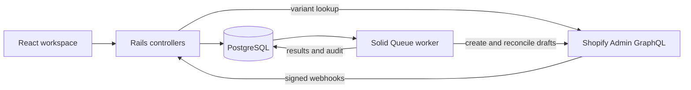
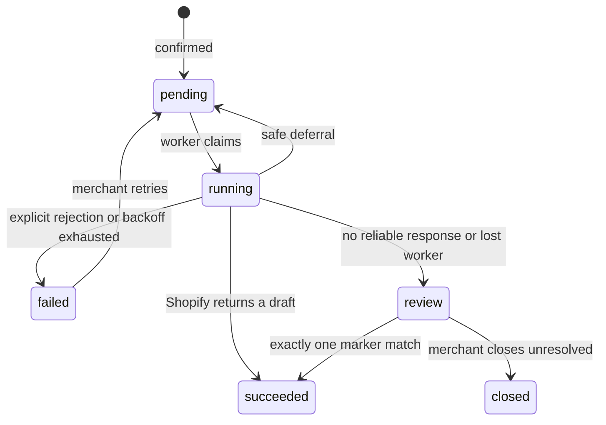

# BatchCart

BatchCart turns a CSV of recipients and SKUs into Shopify draft orders. It is for cases like a school fundraiser where the organizer sends one spreadsheet and the merchant needs a separate draft for each recipient. The [Shopify community thread](https://community.shopify.com/t/can-you-use-a-customer-segment-to-create-bulk-orders/379437) describes that workflow.

## Run it locally

Docker and Compose are enough. On PowerShell, use `Copy-Item .env.example .env` in the first step.

```sh
cp .env.example .env
docker compose up -d --build
```

Open [localhost:3000](http://localhost:3000) and choose **Open demo shop**. Upload [the mixed CSV](test/fixtures/files/mixed.csv). Record 4 has a quantity of zero. Click its record number, enter `1`, and save. The new version previews two orders, with two products on the first. Confirm, wait for the drafts to appear, and export the CSV. Import [the template](public/order-template.csv) again to see the duplicate warning.

The demo uses a local catalog and a PostgreSQL table for simulated Shopify drafts. The browser still goes through Rails, CSRF checks, Postgres, and a separate Solid Queue worker.

## Connect a Shopify dev store

1. Create a [Shopify dev store](https://shopify.dev/docs/apps/build/stores/development-stores) and an app in Dev Dashboard. Use a standalone app and configure its installation, callback and webhooks using [the example TOML](shopify.app.example.toml). If using Shopify CLI, copy it to `shopify.app.local.toml`, fill in the client ID and URLs, and deploy that configuration to your development app. App URLs and callbacks must use your public HTTPS URL.
2. Enable the development app's protected customer data access for names, shipping addresses and email, as described in [Shopify's setup steps](https://shopify.dev/docs/apps/launch/protected-customer-data). Development access and distribution are configured in Dev Dashboard.
3. Point an HTTPS tunnel or proxy at the local web service. Set `BATCHCART_DEMO=0`, `APP_URL`, `SHOPIFY_DEV_SHOPS` (comma-separated `.myshopify.com` domains), `SHOPIFY_CLIENT_ID`, and `SHOPIFY_CLIENT_SECRET` in `.env`. Generate two independent secrets for `SECRET_KEY_BASE` and `DATA_ENCRYPTION_KEY` with `openssl rand -hex 64` or `docker run --rm ruby:3.4-slim ruby -rsecurerandom -e 'puts SecureRandom.hex(64)'`. Keep them stable across restarts and share the same values with the web and worker processes.
4. Restart the project with `docker compose up -d`. Add products with SKUs `GIFT-MUG`, `GIFT-TEE`, and `GIFT-NOTE` to the dev store. Open the HTTPS app URL and connect as the store owner. Upload only synthetic recipient data. For a first check, upload the header and first data row from the template to create one draft; use the full template to exercise the batch flow.
5. Open the draft from the results table and verify the products, quantities and shipping address in Shopify Admin. Edit the draft in Shopify and check the activity history after the sync job runs.

Shopify authenticates the merchant via the authorization code grant. The online grant checks the store owner. The offline grant supplies a renewable token for the worker. Tokens and imported recipient fields are encrypted in Postgres. The API is pinned to `2026-10` and requests product reads plus draft-order reads and writes. [Shopify's standalone authentication guide](https://shopify.dev/docs/apps/build/authentication-authorization/authenticate-standalone-apps)

## How it works



Each order reference can have multiple SKU records with the same recipient. Validation resolves exact SKUs to variant IDs. A missing SKU, multiple exact variants, or two lines for the same SKU prevents confirmation of the entire batch. CSV records are numbered from 2 after the header. The template uses UTF-8, and each upload can contain up to 1,500 records or 1 MB.

The preview is a versioned snapshot. An edit creates a successor, and the database protects the stored contents. The confirmation transaction locks the shop and recomputes duplicate fingerprints. The fingerprint uses normalized recipient details and variant IDs with quantities, so changing the CSV reference or row order will still warn about the same shipment. A merchant can acknowledge the exact list of flagged order references.



The worker commits the claim before contacting Shopify. A PostgreSQL advisory lock serializes API work for a shop, while different shops can proceed independently. The scheduler scans for eligible work every 15 seconds, including confirmations committed just before a queue handoff failed. Pause blocks future claims. An in-flight request can finish.

Shopify receives a unique `bc-…` tag on each draft. A timeout or a stale claim goes to **Needs reconciliation**, where BatchCart searches Shopify with that tag. A missing or ambiguous match stays in review. The merchant can ask for another lookup or close the item after investigating it. A late result and a delayed Shopify search index are both possible, so closing a review item records the decision without retrying the mutation. There is no cross-system exactly-once guarantee.

HTTP 429 and GraphQL throttles back off before another mutation. The worker reads Shopify's query-cost budget and shares cooldowns across the shop. Explicit validation rejections are available for retry. A permission rejection pauses the batch so the owner can reconnect before sending more work.

Webhook deliveries are HMAC-verified and deduplicated by delivery ID. Draft webhooks schedule a GraphQL read instead of applying the payload's status. Sync rejects older Shopify timestamps, and periodic reads catch missed events. Batch activity and CSV results preserve the order reference and Shopify draft ID. Logs include the local batch and order IDs and Shopify's request ID when available.

## Tests and measurements

```sh
docker compose run --rm -e RAILS_ENV=test -e DATABASE_URL=postgres://batchcart:batchcart@db/batchcart_test migrate sh -ec 'bundle exec rails db:prepare && bundle exec rails test'
docker compose run --rm e2e
```

Minitest covers confirmation and duplicate submissions, concurrent work, interrupted jobs, rate limits, unknown outcomes, webhook replay, and shop isolation. Playwright runs the import, correction, confirmation and export against the demo shop. GitHub Actions runs both suites with Compose.

Run the benchmark against a fresh test database with the command below. The arguments are order count and number of trials.

```sh
docker compose run --rm -e RAILS_ENV=test -e DATABASE_URL=postgres://batchcart:batchcart@db/batchcart_bench migrate sh -ec 'bundle exec rails db:prepare && bundle exec rails runner script/benchmark.rb 500 3'
```

Local measurements on Docker Desktop with Ruby 3.4.12 and PostgreSQL 17. Each row is the median of three runs with one CSV record per order.

| Orders | Parse, validate and save | Process and record simulated drafts |
| ---: | ---: | ---: |
| 100 | 18.2 ms | 828.3 ms |
| 500 | 81.2 ms | 4,203.1 ms |
| 1,500 | 211.1 ms | 12,765.1 ms |

The script calls the worker directly in the Rails test environment. The times include database writes and audit events. Shopify network latency, API throttling and queue polling are outside this measurement.

## Deployment and limits

Use the same image for the web and worker processes. Set `RAILS_ENV=production`, provide the Shopify and encryption settings above plus `DATABASE_URL`, and run `bundle exec rails db:prepare` before starting either process. Run the web behind an HTTPS reverse proxy using the hostname in `APP_URL` and run the worker with `bundle exec rake solid_queue:start`. Use a Postgres connection that preserves session-level advisory locks. The Compose password and bind address are for local development.

- The connection flow is scoped to allowlisted development stores and store owners. A live store demo requires a Shopify dev app and dev store. App Store distribution, staff roles, and retention or erasure workflows would need separate work before accepting live customer data.
- The CSV validates quantity, recipient consistency and basic address fields. Shopify does the final address, variant and availability checks. A SKU can change after validation, and the preview has no price or shipping quote.
- The activity pane shows the latest 100 events. Review tags have to remain on the Shopify draft for automatic recovery.
- Draft creation leaves payment, customer email, fulfillment and inventory reservation to the merchant.
